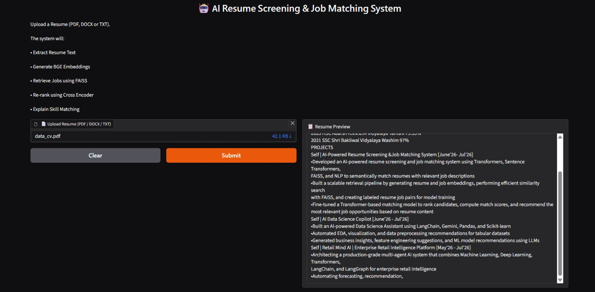
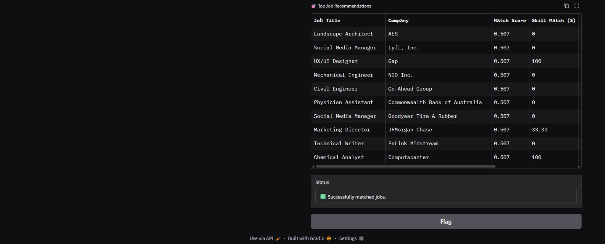

<div align="center">

# AI Resume Screening & Job Matching System

**Semantic resume-to-job matching powered by Sentence Transformers, FAISS, and Cross-Encoder re-ranking**

**`Python`** · **`PyTorch`** · **`🤗 Transformers`** · **`FAISS`** · **`Gradio`** · **`MIT License`**

An AI-powered Resume Screening and Job Matching System that recommends the most relevant job opportunities based on resume content. It combines **semantic retrieval**, **intelligent re-ranking**, and **explainable skill matching**, delivered through an interactive **Gradio** web app.

[Features](#-features) • [Demo](#-application-screenshots) • [Architecture](#-project-workflow) • [Installation](#-installation) • [Usage](#️-running-the-project)

</div>

---

## 📌 Features

|                                 |                                                             |
| ------------------------------- | ----------------------------------------------------------- |
| 📄 **Multi-format Parsing**     | Extracts text from PDF, DOCX, and TXT resumes               |
| 🔍 **Semantic Retrieval**       | FAISS-powered similarity search over job embeddings         |
| 🧠 **BGE Embeddings**           | High-quality resume & job representations via BAAI BGE      |
| 🤝 **Cross-Encoder Re-ranking** | Fine-tuned transformer refines the top candidate matches    |
| 🎯 **Skill Matching**           | Extracts skills and computes match/missing skill breakdowns |
| 📊 **Top-10 Recommendations**   | Ranked job list with match scores and skill match %         |
| 🖥️ **Interactive UI**           | Clean Gradio interface — no setup beyond `pip install`      |

---

## 🏗️ Project Workflow

```text
                 ┌────────────────┐
                 │     Resume     │
                 └───────┬────────┘
                         ▼
                 Extract Resume Text
                         ▼
                Generate BGE Embeddings
                         ▼
              Retrieve Top Jobs (FAISS)
                         ▼
              Cross-Encoder Re-ranking
                         ▼
           Skill Matching & Explainability
                         ▼
                 ┌────────────────┐
                 │  Top Job Recs  │
                 └────────────────┘
```

---

## 🖼️ Application Screenshots

<table>
<tr>
<td width="50%" align="center"><b>Home Page</b></td>
<td width="50%" align="center"><b>Job Recommendations</b></td>
</tr>
<tr>
<td>

Upload a resume (PDF, DOCX, or TXT) and preview the extracted text alongside the processing pipeline steps.



</td>
<td>

View the top-ranked job matches with match scores, company names, and skill match percentages.



</td>
</tr>
</table>

---

## 📂 Project Structure

```
AI-Resume-Screening-and-Job-Matching-System/
│
├── notebooks/
│   ├── 01_Data_Preprocessing_and_FAISS_Indexing.ipynb
│   ├── 02_Cross_Encoder_Training.ipynb
│   ├── 03_Resume_Retrieval_and_Re_Ranking.ipynb
│   ├── 04_Resume_Job_Explainability.ipynb
│   └── 05_AI_Resume_Screening_and_Job_Matching_App.ipynb
│
├── models/
│   └── embedding_model.txt
│
├── screenshots/
│   ├── home.jpg
│   └── results.jpg
│
├── requirements.txt
├── .gitignore
├── LICENSE
└── README.md
```

---

## ⚙️ Technologies Used

| Category                   | Tools                                         |
| -------------------------- | --------------------------------------------- |
| **Language**               | Python                                        |
| **Deep Learning**          | PyTorch, Transformers (Hugging Face)          |
| **Embeddings & Retrieval** | Sentence Transformers, FAISS                  |
| **ML / Data**              | Scikit-learn, Pandas, NumPy                   |
| **Text Processing**        | FlashText, RapidFuzz, PDFPlumber, Python-docx |
| **Interface**              | Gradio                                        |

---

## 🧠 Models Used

| Role                 | Model                                                                | Purpose                                                              |
| -------------------- | -------------------------------------------------------------------- | -------------------------------------------------------------------- |
| **Embedding Model**  | `BAAI/bge-small-en-v1.5`                                             | Generates semantic embeddings for resumes and job descriptions       |
| **Re-ranking Model** | Fine-tuned Cross-Encoder (base: `microsoft/MiniLM-L12-H384-uncased`) | Computes the final matching score between resumes and retrieved jobs |

---

## 🚀 Installation

**1. Clone the repository**

```bash
git clone https://github.com/Adityace05/AI-Resume-Screening-and-Job-Matching-System.git
cd AI-Resume-Screening-and-Job-Matching-System
```

**2. Install dependencies**

```bash
pip install -r requirements.txt
```

---

## ▶️ Running the Project

Run the notebooks in order:

| Step | Notebook                                            | Purpose                                                 |
| ---- | --------------------------------------------------- | ------------------------------------------------------- |
| 1    | `01_Data_Preprocessing_and_FAISS_Indexing.ipynb`    | Preprocess data, generate embeddings, build FAISS index |
| 2    | `02_Cross_Encoder_Training.ipynb`                   | Train the Cross-Encoder re-ranking model                |
| 3    | `03_Resume_Retrieval_and_Re_Ranking.ipynb`          | Retrieve and re-rank candidate jobs                     |
| 4    | `04_Resume_Job_Explainability.ipynb`                | Generate skill match explanations                       |
| 5    | `05_AI_Resume_Screening_and_Job_Matching_App.ipynb` | 🚀 Launches the Gradio web application                  |

---

## 📈 Pipeline

```
Resume Preprocessing → Job Preprocessing → Embedding Generation → FAISS Indexing
        → Candidate Retrieval → Cross-Encoder Re-ranking → Skill Extraction
                → Explainable Recommendations → Gradio Deployment
```

---

## 📊 Output

The system returns, per resume:

- ✅ Resume Preview
- ✅ Top Job Recommendations
- ✅ Match Score
- ✅ Skill Match Percentage
- ✅ Matched Skills
- ✅ Missing Skills

---

## ⚠️ Note

> Large datasets, FAISS indices, embeddings, and trained model weights are **not included** in this repository — they exceed GitHub's file size limits.

To regenerate them:

1. Run **Notebook 1** → preprocess data, generate embeddings, build the FAISS index
2. Run **Notebook 2** → train the Cross-Encoder model
3. Run **Notebook 5** → launch the application

---

## 👨‍💻 Author

<div align="center">

**Aditya Santosh Khade**

B.Tech Civil Engineering · Indian Institute of Technology Kharagpur

🔗 [LinkedIn](https://www.linkedin.com/in/aditya-khade-81b630322?utm_source=share_via&utm_content=profile&utm_medium=member_android) &nbsp;·&nbsp; 💻 [GitHub](https://github.com/Adityace05)

</div>

---

<div align="center">

### ⭐ If you found this project useful, consider giving it a star!

</div>
